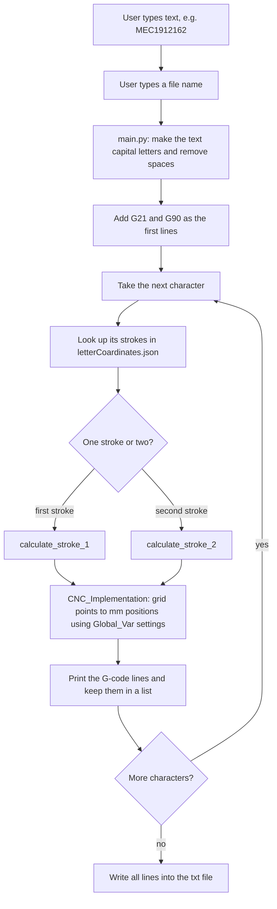

# Automating G-Code Generation to Print Letters and Numbers

> Type a register number (for example `MEC1912162`) and this Python program writes the **G-code** that tells a CNC machine how to engrave it.

---

## Table of contents

1. [What is this project?](#1-what-is-this-project)
2. [Explain like I'm 5](#2-explain-like-im-5)
3. [What does it do? (input and output)](#3-what-does-it-do-input-and-output)
4. [Applications](#4-applications)
5. [Advantages](#5-advantages)
6. [Words you need to know](#6-words-you-need-to-know)
7. [Project structure](#7-project-structure)
8. [How the program works, step by step](#8-how-the-program-works-step-by-step)
9. [The letter file: `letterCoardinates.json`](#9-the-letter-file-lettercoardinatesjson)
10. [Global variables: change size and depth](#10-global-variables-change-size-and-depth)
11. [Programming concepts used](#11-programming-concepts-used)
12. [How this project was built (the journey)](#12-how-this-project-was-built-the-journey)
13. [How to run it](#13-how-to-run-it)
14. [How to check the result before using a machine](#14-how-to-check-the-result-before-using-a-machine)
15. [How to add a new letter or symbol](#15-how-to-add-a-new-letter-or-symbol)
16. [Safety notes](#16-safety-notes)
17. [Limitations and ideas for the future](#17-limitations-and-ideas-for-the-future)

---

## 1. What is this project?

A CNC machine can move a cutting tool very precisely, but it does not understand words like "write the letter E". It only understands **G-code**: a list of short commands such as "go to X=10, Y=20" or "move down 0.3 mm".

Writing G-code by hand for every letter and number is slow and easy to get wrong. This project does that work automatically:

1. The user types text (letters and numbers).
2. The program looks up the shape of every character.
3. The program calculates the exact position of every point.
4. The program prints the G-code **and saves it in a text file**. The user chooses the name of that file.

---

## 2. Explain like I'm 5

Imagine you want a robot arm to **draw your name** on a wall.

- The robot can't read. It only knows steps like "go here", "put the pen down", "go there", "lift the pen up".
- So you give it a **drawing recipe** for every letter. For the letter **L**: "start at the top, go straight down, then go right".
- When someone says "write `LE`", you take the recipe for L, then the recipe for E, and you put the E a little to the right so the letters don't sit on top of each other.
- Then you write all the steps as a list. That list is the **G-code**.

This project is the **recipe book** (the JSON file) plus the **helper** (the Python code) that reads the recipes, puts the letters side by side, and writes the list of steps.

---

## 3. What does it do? (input and output)

**Input**: two things are asked in the terminal:

1. a text made of capital letters and digits that exist in the letter file (the current file contains `M`, `E`, `C` and the digits `0`-`9`),
2. a name for the output file.

```
Enter your register number = E
Enter the file name = E_engraving
```

**Output**: the G-code lines are printed in the terminal **and** saved in a text file with the name you typed (here `E_engraving.txt`, created in the folder where you started the program). Example for the single letter `E`:

```
G21
G90
G00 X16.000 Y20.250
G00 Z0.500
G01 Z-0.300 F10.000
G01 X10.000 Y20.250 F30.000
G01 X10.000 Y9.750
G01 X16.000 Y9.750
G00 Z5.000
G00 X10.000 Y15.000
G00 Z0.500
G01 Z-0.300 F10.000
G01 X15.250 Y15.000 F30.000
G00 Z5.000
```

The text file contains exactly these lines, one command per line.

The letter `E` needs **two strokes** (two separate lines): the "C" shaped part, and the middle bar. Each stroke follows the same five steps:

| Step | G-code | Meaning |
|------|--------|---------|
| 1 | `G00 X.. Y..` | Move quickly to the start of the stroke (tool is high up) |
| 2 | `G00 Z0.500` | Come down to just above the material |
| 3 | `G01 Z-0.300 F10.000` | Slowly push the tool into the material |
| 4 | `G01 X.. Y..` (repeated) | Draw the line point by point (`F30.000` sets the cutting speed) |
| 5 | `G00 Z5.000` | Lift the tool up high again |

The first two lines, `G21` and `G90`, tell the machine (or viewer) to use **millimetres** and **absolute coordinates**.

---

## 4. Applications

- Engraving **register numbers, names or serial numbers** on plates, tags and parts.
- **Part marking** in workshops (labels, ID numbers).
- A learning tool for students: see how text becomes machine movement.
- A starting point for pen plotters or laser engravers (the Z-axis lines would be replaced by pen up/down or laser on/off commands).
- A base for building a bigger engraving program with a full alphabet or other fonts.

---

## 5. Advantages

- **No manual calculation**: the program computes every X and Y position.
- **Fewer mistakes**: no typing of hundreds of coordinates by hand.
- **Always the same spacing**: all letters have the same size and gap.
- **Easy to resize**: change one number to make the text bigger or deeper (see [Global variables](#10-global-variables-change-size-and-depth)).
- **Easy to extend**: new characters are added in a data file, without changing the program code.
- **Clean, organised code**: the work is split into small files with one job each.
- **Safe movement pattern**: the tool always lifts up before moving to the next stroke.
- **Result is saved**: the G-code is written to a text file with a name you choose, so you can keep it, copy it or load it later.

---

## 6. Words you need to know

| Word | Simple meaning |
|------|----------------|
| **CNC** | A machine that moves a tool by numbers, controlled by a computer. |
| **G-code** | The list of commands a CNC machine understands. |
| **X, Y** | Position on the flat surface. X = left/right, Y = forward/back. |
| **Z** | Height. Positive Z = tool above the material, negative Z = inside the material. |
| **Stroke** | One continuous line drawn without lifting the tool. The letter `E` has 2 strokes, the letter `M` has 1. |
| **`G00`** | Fast move (tool is in the air, not cutting). |
| **`G01`** | Straight cutting move at a set speed. |
| **`F`** | Feed rate: how fast the tool moves (mm per minute). |
| **`G21`** | Use millimetres. |
| **`G90`** | Use absolute positions (every number is measured from the origin, not from the last point). |
| **Origin (0, 0)** | The corner of the workpiece that all coordinates are measured from. |
| **JSON** | A simple text format to store data (here: the shapes of the letters). |

---

## 7. Project structure

```
Automating-G_Code-Generation-to-print-letters-and-numbers/
│
├── main.py                  <- start here: asks for text and runs everything
├── CNC_Interface.py         <- the "contract": which methods every CNC class must have (abstraction)
├── CNC_Implementation.py    <- the "worker": calculates positions and prints the G-code
├── Global_Var.py            <- the settings: size, depth, speeds, start position
├── letterCoardinates.json   <- the "recipe book": the shape of every letter and number
├── README.md                <- this file
└── <your file name>.txt     <- created when you run the program: the saved G-code
```

(`__pycache__/` is a folder Python creates automatically. You can ignore it.)

### What each file does

| File | Job | Think of it as |
|------|-----|----------------|
| `main.py` | Reads the JSON file, asks the user for the text and the file name, goes through the text letter by letter, tells the worker to calculate each stroke, and saves all lines in the text file at the end. | The **manager** |
| `CNC_Interface.py` | Declares the abstract methods (`calculate_stroke_1`, `calculate_stroke_2`) that any CNC class must provide. It only describes *what* must exist, not *how* it works. | The **job description** |
| `CNC_Implementation.py` | Fills in the real work: turns letter coordinates into millimetre positions, prints the G-code lines and keeps them in a list so they can be saved. | The **worker** |
| `Global_Var.py` | One place for all settings (class `GlobalVariables`). | The **settings panel** |
| `letterCoardinates.json` | Stores the points of every character on a small grid. | The **recipe book** |

---

## 8. How the program works, step by step



In words:

1. **Input.** `main.py` asks for the text and for the name of the output file. It converts the text to capital letters and removes spaces, so `mec 12` becomes `MEC12`.
2. **Header.** The first lines are `G21` and `G90`.
3. **Loop over the characters.** For each character it remembers the position in the text (0 for the first, 1 for the second, ...). This position is used to move each letter to the right.
4. **Look up the shape.** The shape comes from the JSON file as a list of points.
5. **Find the strokes.** If a character has two strokes (like `E`, `1`, `3`, `4`, `8`) the data contains two lists, otherwise one.
6. **Calculate positions.** The worker class converts every grid point `(u, v)` into millimetres `(x, y)` with this formula:

   ```
   x = X_start + SCALE * (u + LETTER_SPACING * letter_position)
   y = Y_start + SCALE * v
   ```

   Example with the default values (`X_start = 10`, `Y_start = 9.75`, `SCALE = 1.5`, `LETTER_SPACING = 6`): the point `(4, 7)` of the **second** letter (position 1) becomes `x = 10 + 1.5 * (4 + 6*1) = 25` and `y = 9.75 + 1.5 * 7 = 20.25`.
7. **Print and collect the G-code.** The five-step pattern from [section 3](#3-what-does-it-do-input-and-output) is printed for each stroke, and every line is also added to a list.
8. **Save the file.** When all characters are done, the list is written into the text file (one command per line) with the name the user typed.

---

## 9. The letter file: `letterCoardinates.json`

Every character is drawn on a small grid that is **4 units wide and 7 units tall**. The point `(0, 0)` is the bottom-left corner of the character.

```
 7 |  4 ----- 3        <- E drawn on the grid
   |  |
   |  |
3.5|  |----- (middle bar)
   |  |
   |  |
 0 |  1 ----- 2
   +----------------
      0   1   2   3   4
```

The file stores the points of each stroke:

```json
{
  "M": [[0, 0], [0, 7], [2, 3.5], [4, 7], [4, 0]],
  "E": [
    [[4, 7], [0, 7], [0, 0], [4, 0]],
    [[0, 3.5], [3.5, 3.5]]
  ]
}
```

- `M` is **one stroke**: a single list of points.
- `E` is **two strokes**: a list that contains two lists of points.

Why JSON? Because the shapes are **data**, not code. To change or add a letter you only edit the JSON file. The Python code stays the same.

---

## 10. Global variables: change depth, heights and speeds

The machine settings live in the `GlobalVariables` class in `Global_Var.py`. The worker class receives them as `self.GV`, so to change the engraving you change the value in **one place** and run the program again.

| Variable | Default | What it controls | What happens if you change it |
|----------|---------|------------------|-------------------------------|
| `CUT_Z` | `-0.300` | Engraving depth in mm (negative = inside the material) | `-0.600` cuts twice as deep |
| `SAFE_Z` | `5.000` | Lift height between strokes in mm | Higher = more clearance when moving |
| `APPROCH_Z` | `0.500` | Height where the slow plunge starts in mm (the name is spelled `APPROCH` in the code) | Lower = shorter slow movement |
| `FEED_Z` | `10.000` | Plunge speed in mm/min | Higher = faster, but harder on the tool |
| `FEED_XY` | `30.000` | Cutting speed in mm/min | Higher = faster engraving |

**Letter size, start position and spacing** are currently numbers written directly in the formulas in `CNC_Implementation.py`:

| Number | Meaning |
|--------|---------|
| `1.5` | Size: millimetres per grid unit (a letter is 4 x 7 units, so 6 x 10.5 mm) |
| `10` and `9.75` | Start position X and Y of the first letter on the workpiece (mm) |
| `6` | Letter spacing in grid units (the distance from one letter start to the next) |

**Do you want a larger text and a deeper cut?**

- Deeper: make `CUT_Z` more negative in `Global_Var.py`.
- Larger: change `1.5` in the formulas to a bigger number (for example `3.0` makes every letter twice as wide and tall). Change it in **both** `calculate_stroke_1` and `calculate_stroke_2`.

Two things to remember:

- **Check the size of your workpiece.** The text width in mm is about
  `X_start + SCALE * (6 * (number_of_characters - 1) + 4)`.
  For 10 characters with the default settings: `10 + 1.5 * (6*9 + 4) = 97 mm`.
- **Deep cuts need care.** A very deep cut in one go can overload a small tool. Ask the machine owner or instructor for safe values.

---

## 11. Programming concepts used

This project grew from a short script into a small, well-organised program. Here are the ideas that were used, explained simply.

### Functional (script) style to OOP

- **First version (functional / script style):** one file, one long loop, `print` statements. It works, but everything is mixed together.
- **Final version (OOP, object-oriented programming):** the work is split into **classes**, each with one job.

### Class and object

- A **class** is a blueprint. Like the plan of a house.
- An **object** is a real thing built from the blueprint. Like a house built from the plan.
- In this project `main` (manager), `CNCInterface` (job description), `CNCImplementation` (worker) and `GlobalVariables` (settings) are classes, and the program creates objects from them.

```python
CNCImplementation = CI.CNCImplementation(GV())   # an object made from the class
```

### Abstraction (`CNC_Interface.py`)

Abstraction means **showing what must be done without saying how**. The interface lists the methods that every CNC class must have (for example `calculate_stroke_1` and `calculate_stroke_2`) but leaves the details empty. A class that follows the interface is forced to provide them.

Why it helps: `main.py` only needs to know *which methods exist*. If you later write a different worker (for example for a laser engraver), `main.py` does not have to change.

### Inheritance and implementation (`CNC_Implementation.py`)

`CNCImplementation` **inherits** from the interface: `class CNCImplementation(CNC_Interface.CNCInterface)`. A child class gets what the parent class defines and must provide the methods the parent demands. Here it fills in the real calculations. This is how the *what* (interface) is separated from the *how* (implementation).

### Encapsulation (private data)

In `main.py` the loaded letter data is stored as a **private** attribute (`self.__letterCoardinates`). The double underscore means "only this class should touch it". Other parts of the program must ask the class (for example through the `strokes()` method) instead of changing the data directly. This protects the data from accidental changes.

### Dependency injection

The settings object `GV()` is **handed to** the worker class when it is created (`def __init__(self, GV)` stores it as `self.GV`), instead of the worker creating it by itself. So the worker always uses whatever settings you give it.

### JSON (data separated from code)

Letter shapes live in `letterCoardinates.json` and are loaded with Python's `json` module (`json.load`). Data and logic are separate, so you can change one without touching the other.

### File handling (saving the G-code)

While the program runs, every G-code line is added to a **list**. At the end, one block writes the list into a text file:

```python
with open(file_name, "w") as file:
    file.write("\n".join(lines))
```

- `file_name` comes from `input()`, so the **user chooses** the name of the file.
- `"w"` means *write*: a new file is created, and an existing file with the same name is replaced.
- `"\n".join(lines)` glues the lines together with a line break in between, so every command is on its own line.
- The `with` statement closes the file automatically, even if an error happens.

### Modules and imports

The code is split over several files. `import` and `from ... import ...` connect them (for example `from Global_Var import GlobalVariables as GV`).

### Other Python basics used

- `for` loops with `enumerate()` to get the **position** and the **item** at the same time.
- `if` / `else` to decide between one stroke and two strokes.
- `try` / `except` (exception handling) to show an error message instead of crashing.
- **f-strings**, like `f"G00 X{x:.3f} Y{y:.3f}"`, to build text with numbers (`:.3f` = 3 decimals).
- Tuples/lists for the coordinate points, and a list that collects all G-code lines.
- `input()` and string methods `.upper()` and `.replace()` to clean the user input.

---

## 12. How this project was built (the journey)

1. **The idea.** Turn text into machine movements for a CNC milling exercise: engrave a register number.
2. **Design the letters.** Each character is drawn on a 4 x 7 grid. The points were written down as a Python dictionary.
3. **Calculate coordinates.** A first script converted grid points to millimetre positions with the scale and offset formula and printed them.
4. **Generate G-code.** Every stroke was turned into the five-step pattern: move, approach, plunge, cut, lift.
5. **Check the result.** The printed code was pasted into a G-code viewer to see the toolpath. The header lines `G21` and `G90` were added so the viewer reads millimetres and absolute positions.
6. **Refactor to OOP.** The script was split into `main.py`, an interface, an implementation and a settings class.
7. **Move data into JSON.** The dictionary became `letterCoardinates.json`.
8. **Collect settings in one place.** Depth, heights and feeds went into `Global_Var.py`.
9. **Save the result.** All G-code lines are collected in a list and written to a text file. The user chooses the file name when running the program.

---

## 13. How to run it

**You need:** Python 3 (no extra libraries; `json` is part of Python).

```bash
# 1. Download the project
git clone https://github.com/naveenpandiyan525/Automating-G_Code-Generation-to-print-letters-and-numbers.git
cd Automating-G_Code-Generation-to-print-letters-and-numbers

# 2. Run it
python main.py
```

Then:

1. Type your text when asked, for example `MEC1912162`, and press Enter.
2. Type a name for the output file, for example `MEC1912162_engraving`, and press Enter.
3. The G-code appears in the terminal and is saved in a text file with that name, in the folder where you started the program.
4. Open the text file, copy its content and paste it into a G-code viewer (next section), or load it into your CNC software.

If a file with the same name already exists, it is **overwritten**. Use a new name if you want to keep the old result.

Keep all the files in the **same folder**, because `main.py` loads the other files and the JSON file by name.

---

## 14. How to check the result before using a machine

Always look at the toolpath first.

1. Open a free viewer such as **NC Viewer** (ncviewer.com) in your browser.
2. Open the saved text file, copy all its content and paste it into the editor.
3. Use the top view to read the text. Check that:
   - the characters read left to right, not mirrored,
   - all characters have the same size and gap,
   - the fast moves (`G00`) happen high above the material,
   - the text fits on your workpiece.

If nothing appears, check that the pasted text contains **only** G-code lines (no prompt text like `Enter your register number =`) and that `G21` and `G90` are at the top of the file.

---

## 15. How to add a new letter or symbol

1. Draw the character on the 4 x 7 grid on paper.
2. List the points in drawing order. Start a **new stroke** every time the tool would have to lift.
3. Add an entry to `letterCoardinates.json`:
   - one stroke: `"L": [[0, 7], [0, 0], [4, 0]]`
   - two strokes: `"T": [[[0, 7], [4, 7]], [[2, 7], [2, 0]]]`
4. Save and run the program with the new character.

No Python code needs to change.

---

## 16. Safety notes

- The speeds, depths and heights in this project are **example values**. They are **not** safe values for every machine and material.
- Always confirm the **material, tool, spindle speed, feeds and machine commands** with the person responsible for the machine.
- Different CNC controllers use slightly different G-code. Check what your controller needs (for example a program start/end line or spindle commands).
- Run a **simulation** first and keep a hand near the emergency stop during the first test.

---

## 17. Limitations and ideas for the future

**Current limitations**

- Only the characters stored in `letterCoardinates.json` are supported. A character that is not in the file causes an error message.
- The program handles one-stroke and two-stroke characters.
- The output is saved as plain text (`.txt`). Some CNC software expects another extension such as `.nc`: rename the file if needed.
- If the chosen file name already exists, the old file is overwritten without a warning.
- The spindle commands (`M03`, `M05`) and an end-of-program command are not part of the example output above. Add them if your machine needs them.

**Ideas for the future**

- Let the user choose the file extension (for example `.nc`) and warn before overwriting an existing file.
- Move the letter size, start position and spacing into `Global_Var.py`.
- Add the full alphabet `A`-`Z` and symbols.
- Support characters with more than two strokes.
- Draw a toolpath preview with `matplotlib`.
- Support several text lines and automatic checks that the text fits on the workpiece.
- Multi-pass cutting for deeper engraving.
- A graphical interface instead of the terminal.

---

*Made as a learning project for CNC programming and Python.*
